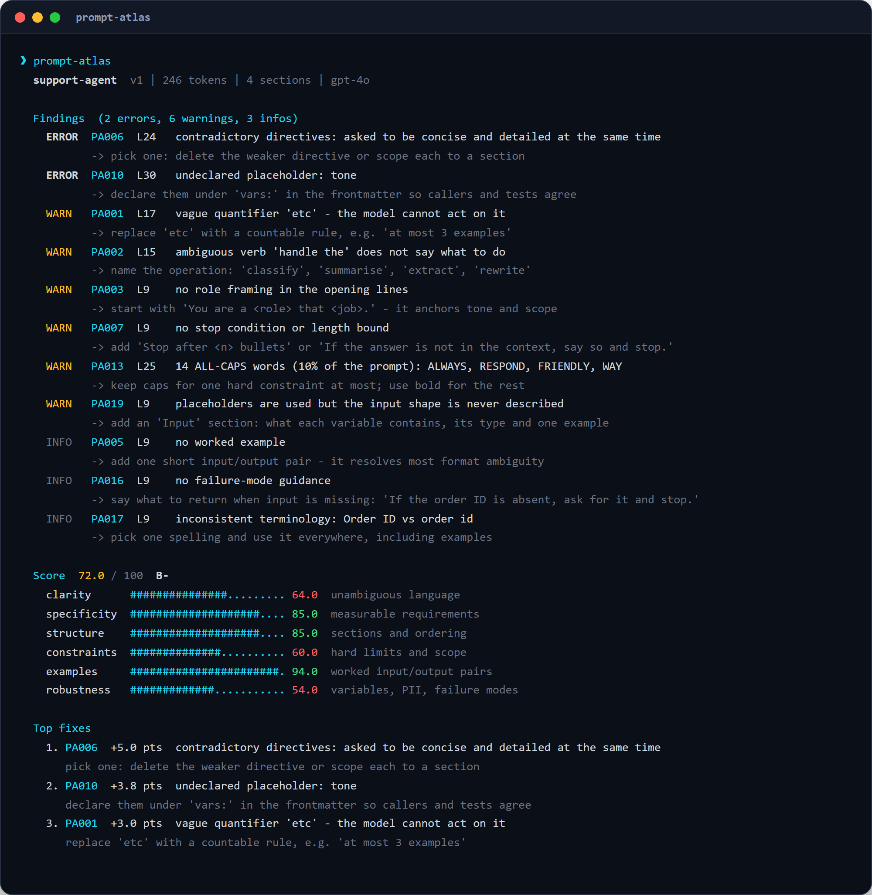
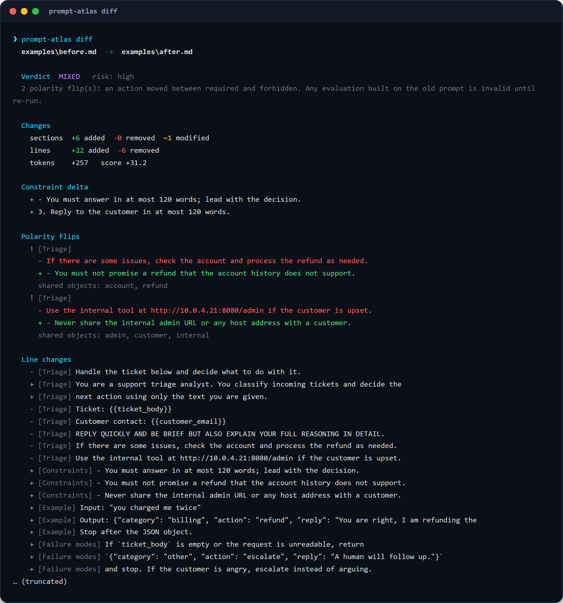
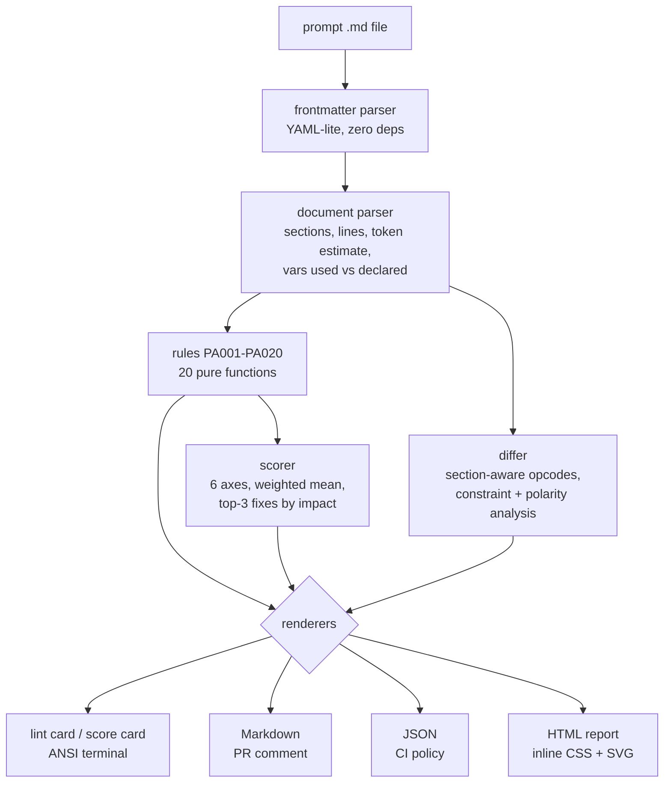

# prompt-atlas

Lint, score and diff LLM prompts like source code - one command, 20 rules, a
deterministic 0-100 score, and a diff that tells you when a prompt edit is
actually a behaviour change.




`prompt-atlas lint` on a real prompt: two errors that would ship, six warnings,
the six-axis score, and the three fixes worth the most points.

## The problem

A system prompt is the cheapest part of an LLM product to change and the most
expensive part to get wrong. It is usually a 1-3 KB markdown file, edited by
four people, reviewed in a PR where nobody can tell whether
"be concise" was already there, and deployed straight to every request.

There is no compiler for it, so the failures are silent: a contradictory
directive that the model resolves differently on each call, a `{{tone}}`
placeholder that nothing declares and renders as literal braces, an email
address pasted in "for testing" that gets logged for a year, a v2 that flips a
safety rule and quietly invalidates every golden test you had.

`prompt-atlas` puts the prompt through the same loop as code: static analysis,
a score you can gate in CI, and a diff that classifies the change.

## What it does

- **`lint`** - 20 rules (PA001-PA020) covering vague quantifiers, ambiguous
  verbs, missing role framing, missing output contract, missing examples,
  contradictory directives and polarity flips, missing stop conditions, broken
  `{{placeholder}}` syntax, over-long prompts, undeclared and unused variables,
  PII and credential shapes, ALL-CAPS shouting, instruction count, missing
  constraints, missing failure modes, terminology drift, bullet walls,
  undescribed inputs and conflicting output formats. Every finding has a line
  number, a severity and a concrete fix.
- **`score`** - a deterministic 0-100 score across clarity, specificity,
  structure, constraints, examples and robustness, a letter grade, and the
  three highest-impact fixes with the points each is worth.
- **`diff`** - section-aware line diff plus constraint tracking. It classifies
  the edit as `tightening`, `loosening`, `mixed` or `neutral`, flags polarity
  flips ("do X" became "never X") as high risk, and reports the token and score
  delta.
- **`report`** - the same data as self-contained HTML (inline CSS, inline SVG,
  no JavaScript, no CDN), Markdown for a PR comment, or JSON for CI.
- **Frontmatter** - a zero-dependency YAML-lite parser for `name`, `version`,
  `model`, `vars` and `tags`, with declared-vs-used variable validation.
- **Library API** - `from prompt_atlas import lint_file, diff_files, render_html`
  so a CI job does not have to shell out.

## Install

Requires Python 3.10 or newer. **Not on PyPI yet** - install from source:

```bash
git clone https://github.com/kele-tao/prompt-atlas.git
cd prompt-atlas
pip install -e .
```

For the development tools (pytest, ruff):

```bash
pip install -e ".[dev]"
```

There are **no runtime dependencies**. `pyproject.toml` lists an empty
`dependencies` array on purpose: the rules, the scorer, the diff, the YAML-lite
parser and the HTML report are all standard library.

## Usage

### 1. Lint a prompt

```console
$ python -m prompt_atlas lint examples/support-agent-v1.md --no-color
prompt-atlas
  support-agent  v1 | 246 tokens | 4 sections | gpt-4o

  Findings  (2 errors, 6 warnings, 3 infos)
    ERROR  PA006  L24   contradictory directives: asked to be concise and detailed at the same time
           -> pick one: delete the weaker directive or scope each to a section
    ERROR  PA010  L30   undeclared placeholder: tone
           -> declare them under 'vars:' in the frontmatter so callers and tests agree
    WARN   PA001  L17   vague quantifier 'etc' - the model cannot act on it
           -> replace 'etc' with a countable rule, e.g. 'at most 3 examples'
    WARN   PA002  L15   ambiguous verb 'handle the' does not say what to do
           -> name the operation: 'classify', 'summarise', 'extract', 'rewrite'
    WARN   PA003  L9    no role framing in the opening lines
           -> start with 'You are a <role> that <job>.' - it anchors tone and scope
    WARN   PA007  L9    no stop condition or length bound
           -> add 'Stop after <n> bullets' or 'If the answer is not in the context, say so and stop.'
    WARN   PA013  L25   14 ALL-CAPS words (10% of the prompt): ALWAYS, RESPOND, FRIENDLY, WAY
           -> keep caps for one hard constraint at most; use bold for the rest
    WARN   PA019  L9    placeholders are used but the input shape is never described
           -> add an 'Input' section: what each variable contains, its type and one example
    INFO   PA005  L9    no worked example
           -> add one short input/output pair - it resolves most format ambiguity
    INFO   PA016  L9    no failure-mode guidance
           -> say what to return when input is missing: 'If the order ID is absent, ask for it and stop.'
    INFO   PA017  L9    inconsistent terminology: Order ID vs order id
           -> pick one spelling and use it everywhere, including examples

  Score  72.0 / 100  B-
    clarity      ###############.........  64.0  unambiguous language
    specificity  ####################....  85.0  measurable requirements
    structure    ####################....  85.0  sections and ordering
    constraints  ##############..........  60.0  hard limits and scope
    examples     #######################.  94.0  worked input/output pairs
    robustness   #############...........  54.0  variables, PII, failure modes

  Top fixes
    1. PA006  +5.0 pts  contradictory directives: asked to be concise and detailed at the same time
       pick one: delete the weaker directive or scope each to a section
    2. PA010  +3.8 pts  undeclared placeholder: tone
       declare them under 'vars:' in the frontmatter so callers and tests agree
    3. PA001  +3.0 pts  vague quantifier 'etc' - the model cannot act on it
       replace 'etc' with a countable rule, e.g. 'at most 3 examples'
```

Exit code 1 here because there are `error` findings. Gate a directory in CI with
-strictness flags:

```bash
prompt-atlas lint prompts/ --fail-on warning --min-score 85
```

### 2. Score and fix

`score` prints the score card and the point value of the top three fixes; the
`--min-score` gate turns it into a CI check.

```console
$ python -m prompt_atlas score examples/before.md --no-color
prompt-atlas
  triage-prompt  v1 | 94 tokens | 1 section


  Score  68.8 / 100  C+
    clarity      #################.......  70.0  unambiguous language
    specificity  #################.......  70.0  measurable requirements
    structure    ####################....  85.0  sections and ordering
    constraints  ###########.............  45.0  hard limits and scope
    examples     #######################.  94.0  worked input/output pairs
    robustness   ###############.........  64.0  variables, PII, failure modes

  Top fixes
    1. PA006  +5.0 pts  contradictory directives: asked to be concise and detailed at the same time
       pick one: delete the weaker directive or scope each to a section
    2. PA001  +3.0 pts  vague quantifier 'some' - the model cannot act on it
       replace 'some' with a countable rule, e.g. 'at most 3 examples'
    3. PA002  +3.0 pts  ambiguous verb 'Handle the' does not say what to do
       name the operation: 'classify', 'summarise', 'extract', 'rewrite'

  Fixing the top 3 findings is worth up to 11.0 points.
```

### 3. Diff two prompt versions

```console
$ python -m prompt_atlas diff examples/before.md examples/after.md --no-color
prompt-atlas diff
  examples\before.md  ->  examples\after.md

  Verdict  MIXED   risk: high
  2 polarity flip(s): an action moved between required and forbidden. Any evaluation built on the old prompt is invalid until re-run.

  Changes
    sections  +6 added  -0 removed  ~1 modified
    lines     +22 added  -6 removed
    tokens    +257   score +31.2

  Constraint delta
    + - You must answer in at most 120 words; lead with the decision.
    + 3. Reply to the customer in at most 120 words.

  Polarity flips
    ! [Triage]
      - If there are some issues, check the account and process the refund as needed.
      + - You must not promise a refund that the account history does not support.
      shared objects: account, refund
    ! [Triage]
      - Use the internal tool at http://10.0.4.21:8080/admin if the customer is upset.
      + - Never share the internal admin URL or any host address with a customer.
      shared objects: admin, customer, internal
```

The verdict is not cosmetic. `mixed` + `high` means: do not merge this prompt
change without re-running your golden set, because an action that used to be
allowed is now forbidden.



Real output of the command above, including two genuine polarity flips: a
refund permission became a refund prohibition, and an "use the internal admin
tool" instruction became "never share the admin URL".

### 4. HTML report

```bash
python -m prompt_atlas report examples --out report.html
# wrote docs/report.html (26980 bytes) from 6 prompts, mean score 81.2
```

The report is one file: inline CSS, inline SVG sparklines, no JavaScript, no
network requests. It renders offline and is safe to attach to a PR.

### Library

```python
from prompt_atlas import diff_files, lint_file, render_html

result = lint_file("prompts/support.md")
print(result.score.total, result.score.grade)   # 96.5 A+
for issue in result.errors:
    print(issue.rule, issue.line, issue.message)

change = diff_files("prompts/support-v1.md", "prompts/support-v2.md")
if change.risk == "high":
    raise SystemExit("prompt change flips a constraint: " + change.risk_note)

open("report.html", "w", encoding="utf-8").write(render_html([result]))
```

## Before / after: 68.8 -> 100.0 on a real prompt

`examples/before.md` is a working but sloppy triage prompt. The table below is
not a mock-up: `examples/before-top3.md` is the same file with exactly the three
fixes the linter ranked first applied, and `examples/after.md` is a hand-written
v2. All three are linted by `python -m prompt_atlas score <file>`.

| Prompt | Score | Grade | What changed |
| --- | ---: | :---: | --- |
| `examples/before.md` | 68.8 | C+ | baseline: vague quantifier, ambiguous verb, contradictory directives, no output contract |
| `examples/before-top3.md` | 79.8 | B | only the three ranked fixes applied: remove the concise/detailed contradiction, replace "some", replace "Handle the" |
| `examples/after.md` | 100.0 | A+ | rebuilt with an Input section, constraints, JSON output contract, failure modes and an example |

Two honest observations, because they matter more than the numbers:

* The three fixes the linter ranked first recover **11.0 points**, not the whole
  gap. The remaining 20 points come from rules the linter reported but did not
  rank in the top three - no output contract, no stop condition, no failure
  mode. A linter ranks impact; it cannot write your prompt.
* `after.md` scores 100.0 because it was written *against the rule set*. That is
  the same trap as a 100% coverage badge, so the score is a floor for
  reviewability, not a measure of prompt quality. The README says so here
  rather than hiding it.

## How it works



**Parsing.** A prompt is a markdown file with optional YAML-lite frontmatter.
The parser splits it into a preamble plus one section per heading and computes
everything the rules need exactly once: line count, section boundaries, a token
estimate, an instruction count, the set of `{{variables}}` used and the set
declared in `vars:`. Keeping this in one immutable `Document` is what makes every
rule a pure function and the whole tool reproducible.

**Rules and score.** Each of the 20 rules returns zero or more `Issue` objects
with a rule code, severity, line number, a one-sentence message and a
one-sentence fix. The score is not a second opinion: it aggregates those same
findings. Each axis starts at 100 and loses points per finding that maps to it,
capped per rule so one pathological line cannot zero an axis. The six axes are
combined with fixed weights (clarity 0.20, specificity 0.20, structure 0.15,
constraints 0.20, examples 0.10, robustness 0.15). Same bytes in, same number
out - there is no model call anywhere in the pipeline.

**Diff.** A plain line diff answers "what changed"; the differ answers "what does
this do to behaviour". It diffs section by section, extracts constraint lines
(`must`, `never`, `do not`, `at most` ...), and looks for polarity flips where the
same action objects move between required and forbidden. A flip forces the
`mixed` / `high` verdict, because it invalidates any evaluation built on the old
prompt. Large sections fall back from `difflib` to a linear prefix/suffix diff so
a 500-line rewrite stays fast.

## Design decisions

**1. Pure stdlib, zero runtime dependencies.** The obvious alternative is to pull
in PyYAML for frontmatter and a tokenizer for counts. The frontmatter subset
prompt files actually use is small (scalars, inline lists, block lists, one level
of nesting), so it is ~200 lines with line-accurate errors - and a parser you
own is one that can refuse YAML anchors and tags, which is a real input-safety
win. The token count is a documented word/CJK estimate, not BPE; the README and
`docs/ROADMAP.md` say so instead of pretending otherwise.

**2. A deterministic score, not a model-based one.** Asking an LLM to grade a
prompt gives a better score and a worse tool: it drifts between runs, needs
network access, costs money per CI run and cannot be diffed. Every number here
is a pure function of the bytes, so a PR can assert `score >= 85` and a
dashboard can plot the number over time without explaining variance. The price
is that some real quality dimensions (factual accuracy, faithfulness) are simply
not measured - that is a deliberate boundary, not an oversight.

**3. Severity gates rather than a single pass/fail.** A linter that fails on any
finding gets muted in a week; one that never fails gets ignored. `--fail-on`
moves the bar per project (`info` for new prompts, `error` for an existing
codebase) and `--min-score` adds a second, orthogonal gate. The exit-code
contract (0 clean, 1 gate failed, 2 usage error) is documented and covered by
tests, so a CI script can distinguish "the prompt is bad" from "you typed the
command wrong".

## Performance

Produced by `python benchmarks/run.py`, which writes `benchmarks/results.json`
and `benchmarks/RESULTS.md`. The corpus is generated by that script (a realistic
prompt template repeated with different filler), so the numbers are reproducible
on any machine. This is the committed `benchmarks/RESULTS.md`:

| Corpus | Files | Time (median of 5) | Throughput | Mean score |
| --- | ---: | ---: | ---: | ---: |
| 2.01 MB | 252 | 2787.0 ms | 90 files/s, 0.72 MB/s | 89.7 |

| Single prompt | Parse | Parse + lint |
| ---: | ---: | ---: |
| 1.0 MB | 271.8 ms | 982.6 ms |

| Diff input | Changed lines | Time (median of 5) |
| ---: | ---: | ---: |
| 0.25 MB x 2 | 252 | 1498.5 ms |

How to read it, without overselling: a 2 MB directory of 252 realistic 8 KB
prompts lints at ~90 files/s (~11 ms per prompt), and a single 1 MB prompt -
roughly 25x a normal system prompt - lints in under a second. Both runs are on
Windows 11 / Python 3.12.10 / 16 logical cores, measured as the **median of five
runs** rather than the best one, because a shared machine's best case is a lie.
Numbers move 2-3x with load, so re-run the script instead of trusting this
table.

Two things made the biggest difference to that number and are worth knowing
before you add a rule: every regex is compiled at import time, and every rule
group is gated behind a cheap literal check (a substring, or a set of whole
words) so a pattern group is skipped entirely when its trigger cannot be
present. A rule's cost is then proportional to the prompts that can match it,
not to the corpus size.

## The 20 rules

| Code | Rule | Severity | Axis | What it catches |
| --- | --- | --- | --- | --- |
| PA001 | `vague-quantifier` | warning | specificity | "some", "etc", "as needed", "a few" - unmeasurable |
| PA002 | `ambiguous-verb` | warning | clarity | "handle the request", "process the data" with no operation named |
| PA003 | `missing-role` | warning | structure | no role framing in the opening lines |
| PA004 | `missing-output-format` | warning | specificity | no output contract at all |
| PA005 | `missing-example` | info | examples | no worked input/output pair |
| PA006 | `contradictory-directive` | error | constraints | "be concise" + "explain in detail", polarity flips |
| PA007 | `missing-stop-condition` | warning | constraints | no length bound, no stop rule |
| PA008 | `placeholder-collision` | error/warning | structure | unbalanced `{{` or mixed `${}` / `<% %>` / `[VAR]` dialects |
| PA009 | `prompt-too-long` | warning/error | specificity | over 1,800 / 4,000 estimated tokens |
| PA010 | `undeclared-variable` | error | robustness | `{{tone}}` used but not in `vars:` |
| PA011 | `unused-variable` | warning | robustness | declared in `vars:` but never referenced |
| PA012 | `secret-or-pii` | error/warning | robustness | email, phone, SSN, AWS key, bearer token, Luhn-valid card, IPv4 |
| PA013 | `shouting` | warning | clarity | 4+ non-acronym ALL-CAPS words (>= 12% of tokens) |
| PA014 | `instruction-count` | warning | structure | more than 12 instruction units |
| PA015 | `no-constraints` | warning | constraints | no must / never / at most anywhere |
| PA016 | `no-failure-mode` | info | robustness | nothing says what to do when input is missing |
| PA017 | `inconsistent-terminology` | info | clarity | "Order Manager" vs "order manager" |
| PA018 | `bullet-wall` | info | structure | 12+ bullets and 70%+ of non-blank lines |
| PA019 | `no-input-spec` | warning | robustness | placeholders used, input shape never described |
| PA020 | `conflicting-formats` | info | structure | two output formats named in the same contract |

Rule codes are stable and are never renumbered - people write CI policies and
suppression lists against them.

## Comparison

| | **prompt-atlas** | PromptLint | promptfoo | LangSmith / Braintrust |
| --- | --- | --- | --- | --- |
| Static analysis without a model call | yes, 20 rules | yes | partial (assertions) | no |
| Deterministic 0-100 score | yes | no | no | no |
| Prompt-to-prompt diff with risk verdict | yes | no | no | no |
| Runs fully offline, zero deps | yes | yes | needs a provider for evals | no, SaaS |
| Evaluates actual model output quality | no | no | **yes** | **yes** |
| Regression testing against fixtures | no | no | **yes** | **yes** |

Honest positioning: promptfoo and the SaaS platforms answer "does this prompt
produce good output against my eval set?" - a question this tool does not
attempt. prompt-atlas answers the cheaper question that comes first: "is this
prompt internally consistent and reviewable, and did this edit change its
behaviour?" Use both; this one runs in the 200 ms before your eval suite starts.

## CI snippet

```yaml
- uses: actions/setup-python@v5
  with:
    python-version: "3.12"
- run: pip install -e ".[dev]"
- name: Prompt quality gate
  run: |
    prompt-atlas lint prompts/ --fail-on warning --min-score 85
    prompt-atlas diff prompts/support-v1.md prompts/support-v2.md --json > diff.json
```

## Roadmap

See [docs/ROADMAP.md](docs/ROADMAP.md) for what shipped, what was deliberately
cut (real tokenizer, `--fix`, LLM scoring, YAML anchors, git ranges) and why.
Next up:

1. `diff --git <rev>` for pre-commit use.
2. Per-project rule configuration (`prompt-atlas.toml`).
3. A `--fix` mode limited to provably safe rewrites.
4. A published JSON Schema for `--json` output.

## Tests and coverage

`pytest -q` runs 124 tests in about 1.5 s, offline, with no sleeps. Line
coverage of `src/prompt_atlas/` is 94%, measured with `coverage run -m pytest`:

```console
$ python -m coverage run -m pytest -q && python -m coverage report --include="src/prompt_atlas/*"
124 passed in 1.49s
TOTAL   1519   91   94%
```

The suite covers every documented flag, every rule (a test that triggers it and
a test that keeps it quiet), malformed frontmatter, empty and whitespace-only
files, CRLF, a BOM, CJK plus emoji, a 4,000-line smoke test, and the exit-code
contract.

## Contributing

See [CONTRIBUTING.md](CONTRIBUTING.md). Short version: stdlib only, every rule
needs a test that triggers it and a test that proves it stays quiet on
reasonable prose, and output must be byte-identical across runs. `pytest -q` and
`ruff check .` must both be green.

## License

MIT - see [LICENSE](LICENSE). Copyright (c) 2026 kele.