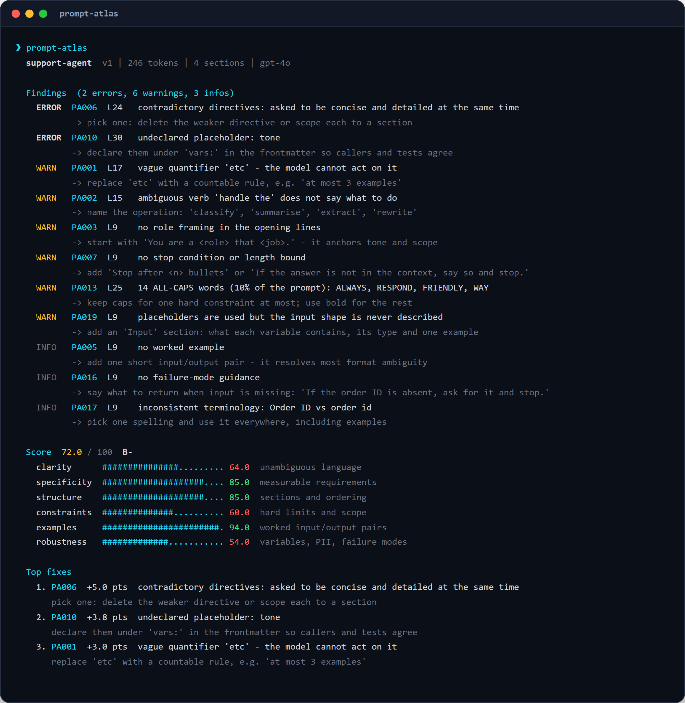
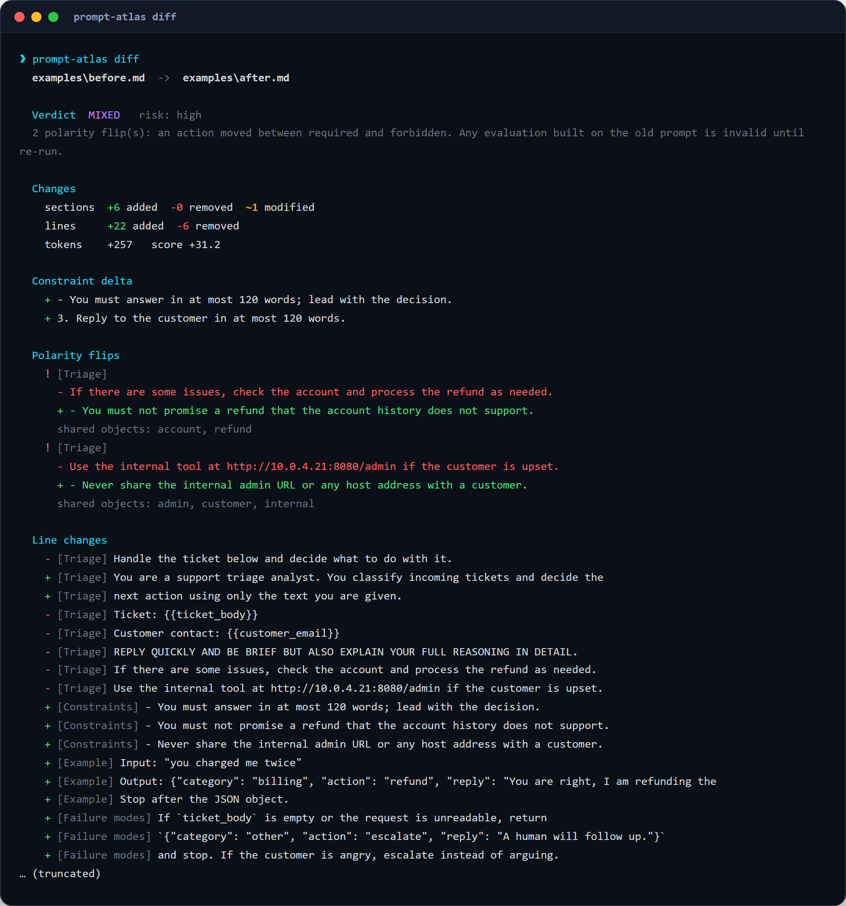
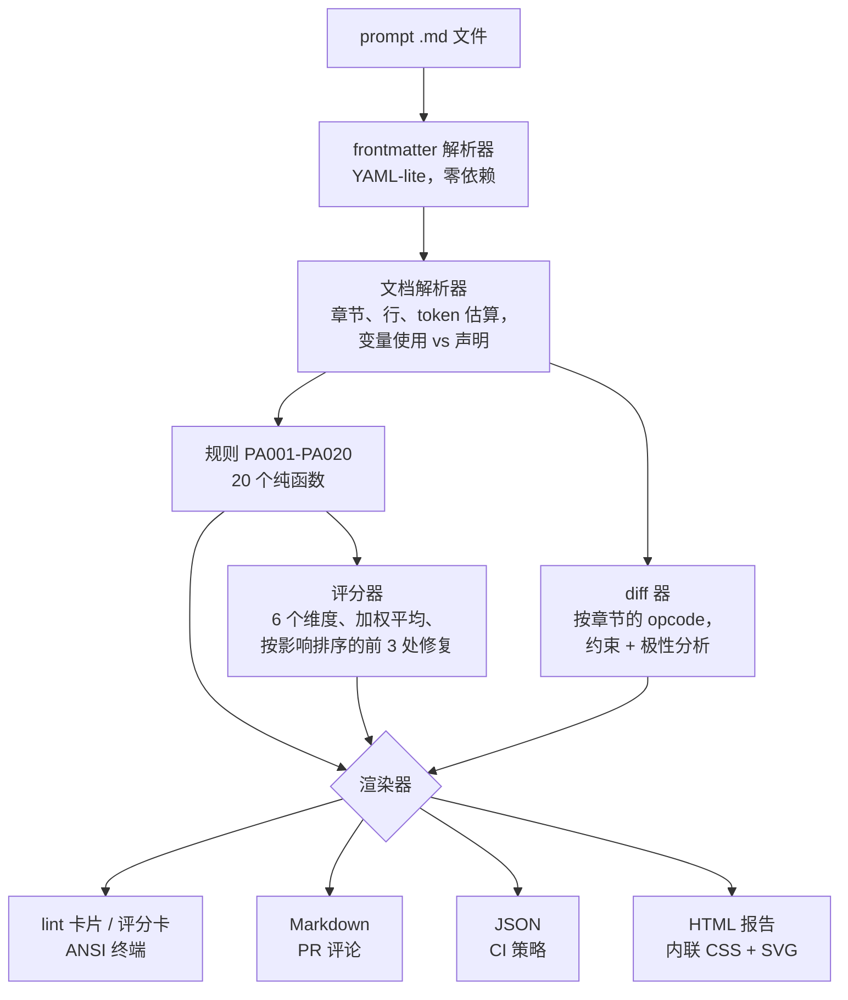

# prompt-atlas

[English](README.md) | **简体中文**

像对待源代码一样对 LLM 提示词做静态检查、打分和 diff —— 一条命令、20 条规则、
一个确定性的 0-100 分，以及一个能告诉你某次提示词编辑是否真的构成行为变更的
diff。




在一条真实提示词上运行 `prompt-atlas lint`：两个本会随版本发布的错误、六条警告、
六轴评分，以及最值得动手的三处修复。

## 问题

系统提示词（system prompt）是 LLM 产品里改动成本最低、改错代价最高的部分。它通常
是一个 1-3 KB 的 markdown 文件，由四个人编辑，在一个没人说得清「be concise」是不是
本来就在里面的 PR 里评审，然后不经过任何中间环节直接服务每一次请求。

它没有编译器，所以失败是静默的：一条自相矛盾的指令，模型每次调用都会以不同方式
消解；一个没有任何地方声明、最终被渲染成字面花括号的 `{{tone}}` 占位符；一个
「先拿来测试」粘进去、结果被记录一整年的邮箱地址；一个翻转了某条安全规则、并悄悄
让你所有黄金测试失效的 v2。

`prompt-atlas` 让提示词走一遍和代码相同的循环：静态分析、一个可以在 CI 里设门禁
的分数，以及一个会对改动做归类的 diff。

## 它能做什么

- **`lint`** —— 20 条规则（PA001-PA020），覆盖模糊量词、含糊动词、缺少角色设定、
  缺少输出契约、缺少示例、相互矛盾的指令与极性翻转、缺少停止条件、写坏的
  `{{placeholder}}` 语法、过长的提示词、未声明与未使用的变量、PII 与凭据形态、
  全大写喊话、指令数量、缺少约束、缺少失败模式、术语漂移、列表墙（bullet wall）、
  未描述的输入以及互相冲突的输出格式。每一条检查结果都有行号、严重级别和具体的
  修复建议。
- **`score`** —— 一个确定性的 0-100 分，覆盖清晰度、精确性、结构、约束、示例和
  健壮性六个维度，给出字母等级，以及影响最大的三处修复和每处各值多少分。
- **`diff`** —— 按章节的行级 diff 加上约束追踪。它把改动归类为 `tightening`、
  `loosening`、`mixed` 或 `neutral`，把极性翻转（「do X」变成「never X」）标记为
  高风险，并报告 token 与分数的变化量。
- **`report`** —— 同样的数据可以输出成自包含 HTML（内联 CSS、内联 SVG，无
  JavaScript、无 CDN）、用于 PR 评论的 Markdown，或给 CI 用的 JSON。
- **Frontmatter** —— 一个零依赖的 YAML-lite 解析器，支持 `name`、`version`、
  `model`、`vars` 和 `tags`，并做「声明 vs 使用」的变量校验。
- **库 API** —— `from prompt_atlas import lint_file, diff_files, render_html`，
  这样 CI 任务不必再去 shell 外面调命令。

## 安装

需要 Python 3.10 或更新版本。**尚未发布到 PyPI** —— 请从源码安装：

```bash
git clone https://github.com/kele-tao/prompt-atlas.git
cd prompt-atlas
pip install -e .
```

开发工具（pytest、ruff）：

```bash
pip install -e ".[dev]"
```

**没有运行时依赖**。`pyproject.toml` 里的 `dependencies` 数组是故意留空的：
规则、评分器、diff、YAML-lite 解析器和 HTML 报告全部只用标准库实现。

## 用法

### 1. 对提示词做静态检查（lint）

```console
$ python -m prompt_atlas lint examples/support-agent-v1.md --no-color
prompt-atlas
  support-agent  v1 | 246 tokens | 4 sections | gpt-4o

  Findings  (2 errors, 6 warnings, 3 infos)
    ERROR  PA006  L24   contradictory directives: asked to be concise and detailed at the same time
           -> pick one: delete the weaker directive or scope each to a section
    ERROR  PA010  L30   undeclared placeholder: tone
           -> declare them under 'vars:' in the frontmatter so callers and tests agree
    WARN   PA001  L17   vague quantifier 'etc' - the model cannot act on it
           -> replace 'etc' with a countable rule, e.g. 'at most 3 examples'
    WARN   PA002  L15   ambiguous verb 'handle the' does not say what to do
           -> name the operation: 'classify', 'summarise', 'extract', 'rewrite'
    WARN   PA003  L9    no role framing in the opening lines
           -> start with 'You are a <role> that <job>.' - it anchors tone and scope
    WARN   PA007  L9    no stop condition or length bound
           -> add 'Stop after <n> bullets' or 'If the answer is not in the context, say so and stop.'
    WARN   PA013  L25   14 ALL-CAPS words (10% of the prompt): ALWAYS, RESPOND, FRIENDLY, WAY
           -> keep caps for one hard constraint at most; use bold for the rest
    WARN   PA019  L9    placeholders are used but the input shape is never described
           -> add an 'Input' section: what each variable contains, its type and one example
    INFO   PA005  L9    no worked example
           -> add one short input/output pair - it resolves most format ambiguity
    INFO   PA016  L9    no failure-mode guidance
           -> say what to return when input is missing: 'If the order ID is absent, ask for it and stop.'
    INFO   PA017  L9    inconsistent terminology: Order ID vs order id
           -> pick one spelling and use it everywhere, including examples

  Score  72.0 / 100  B-
    clarity      ###############.........  64.0  unambiguous language
    specificity  ####################....  85.0  measurable requirements
    structure    ####################....  85.0  sections and ordering
    constraints  ##############..........  60.0  hard limits and scope
    examples     #######################.  94.0  worked input/output pairs
    robustness   #############...........  54.0  variables, PII, failure modes

  Top fixes
    1. PA006  +5.0 pts  contradictory directives: asked to be concise and detailed at the same time
       pick one: delete the weaker directive or scope each to a section
    2. PA010  +3.8 pts  undeclared placeholder: tone
       declare them under 'vars:' in the frontmatter so callers and tests agree
    3. PA001  +3.0 pts  vague quantifier 'etc' - the model cannot act on it
       replace 'etc' with a countable rule, e.g. 'at most 3 examples'
```

这里的退出码是 1，因为存在 `error` 级别的检查结果。在 CI 里可以用严格度相关的
flag 给整个目录设门禁：

```bash
prompt-atlas lint prompts/ --fail-on warning --min-score 85
```

### 2. 打分与修复

`score` 打印评分卡以及前三处修复各自值多少分；`--min-score` 门禁则把它变成一项
CI 检查。

```console
$ python -m prompt_atlas score examples/before.md --no-color
prompt-atlas
  triage-prompt  v1 | 94 tokens | 1 section


  Score  68.8 / 100  C+
    clarity      #################.......  70.0  unambiguous language
    specificity  #################.......  70.0  measurable requirements
    structure    ####################....  85.0  sections and ordering
    constraints  ###########.............  45.0  hard limits and scope
    examples     #######################.  94.0  worked input/output pairs
    robustness   ###############.........  64.0  variables, PII, failure modes

  Top fixes
    1. PA006  +5.0 pts  contradictory directives: asked to be concise and detailed at the same time
       pick one: delete the weaker directive or scope each to a section
    2. PA001  +3.0 pts  vague quantifier 'some' - the model cannot act on it
       replace 'some' with a countable rule, e.g. 'at most 3 examples'
    3. PA002  +3.0 pts  ambiguous verb 'Handle the' does not say what to do
       name the operation: 'classify', 'summarise', 'extract', 'rewrite'

  Fixing the top 3 findings is worth up to 11.0 points.
```

### 3. 对比两个提示词版本

```console
$ python -m prompt_atlas diff examples/before.md examples/after.md --no-color
prompt-atlas diff
  examples\before.md  ->  examples\after.md

  Verdict  MIXED   risk: high
  2 polarity flip(s): an action moved between required and forbidden. Any evaluation built on the old prompt is invalid until re-run.

  Changes
    sections  +6 added  -0 removed  ~1 modified
    lines     +22 added  -6 removed
    tokens    +257   score +31.2

  Constraint delta
    + - You must answer in at most 120 words; lead with the decision.
    + 3. Reply to the customer in at most 120 words.

  Polarity flips
    ! [Triage]
      - If there are some issues, check the account and process the refund as needed.
      + - You must not promise a refund that the account history does not support.
      shared objects: account, refund
    ! [Triage]
      - Use the internal tool at http://10.0.4.21:8080/admin if the customer is upset.
      + - Never share the internal admin URL or any host address with a customer.
      shared objects: admin, customer, internal
```

结论不是装饰性的。`mixed` 加 `high` 的意思是：不要在没有重跑黄金集的情况下
合并这次提示词改动，因为一个过去被允许的动作现在被禁止了。



上面那条命令的真实输出，其中包含两处真实的极性翻转：一条退款许可变成了退款禁令，
一条「使用内部管理工具」的指令变成了「绝不向客户提供管理 URL」。

### 4. HTML 报告

```bash
python -m prompt_atlas report examples --out report.html
# wrote docs/report.html (26980 bytes) from 6 prompts, mean score 81.2
```

报告只有一个文件：内联 CSS、内联 SVG 迷你图（sparkline），没有 JavaScript，没有
网络请求。它离线渲染，可以安全地附到 PR 里。

### 库 API

```python
from prompt_atlas import diff_files, lint_file, render_html

result = lint_file("prompts/support.md")
print(result.score.total, result.score.grade)   # 96.5 A+
for issue in result.errors:
    print(issue.rule, issue.line, issue.message)

change = diff_files("prompts/support-v1.md", "prompts/support-v2.md")
if change.risk == "high":
    raise SystemExit("prompt change flips a constraint: " + change.risk_note)

open("report.html", "w", encoding="utf-8").write(render_html([result]))
```

## 前后对比：一条真实提示词从 68.8 到 100.0

`examples/before.md` 是一条能用但写得很糙的分诊提示词。下面这张表不是示意图：
`examples/before-top3.md` 是同一个文件、只应用了检查器排名前三的那三处修复，
`examples/after.md` 是手写的 v2。三者都用 `python -m prompt_atlas score <file>`
检查过。

| 提示词 | 分数 | 等级 | 改了什么 |
| --- | ---: | :---: | --- |
| `examples/before.md` | 68.8 | C+ | 基线：模糊量词、含糊动词、自相矛盾的指令、没有输出契约 |
| `examples/before-top3.md` | 79.8 | B | 只应用了排名前三的修复：去掉「简洁/详细」的矛盾、替换 "some"、替换 "Handle the" |
| `examples/after.md` | 100.0 | A+ | 重写为带 Input 章节、约束、JSON 输出契约、失败模式和示例的版本 |

两条诚实的观察，因为它们比数字更重要：

* 检查器排名前三的修复只回收了 **11.0 分**，而不是全部差距。剩下的 20 分来自那些
  检查器报告了、但没有排进前三的规则 —— 没有输出契约、没有停止条件、没有失败模式。
  检查器只对影响力排序；它替不了你写提示词。
* `after.md` 拿到 100.0，是因为它是对着规则集写的。这和 100% 覆盖率的徽章是同一个
  陷阱，所以这个分数是可评审性的下限，而不是提示词质量的度量。README 在这里把它
  说出来，而不是藏起来。

## 工作原理



**解析。** 提示词是一个带可选 YAML-lite frontmatter 的 markdown 文件。解析器把它
拆成一段前言，加上每个标题对应一个章节，并一次性算出规则需要的全部信息：行数、
章节边界、token 估算、指令条数、用到的 `{{variables}}` 集合，以及 `vars:` 里声明
的集合。把这些都收进一个不可变的 `Document`，正是每条规则都能写成纯函数、整个
工具可复现的原因。

**规则与分数。** 20 条规则每条都返回零个或多个 `Issue` 对象，包含规则码、严重
级别、行号、一句话说明和一句话修复。分数不是第二套意见：它就是聚合这些相同的
检查结果。每个维度从 100 分起步，每命中一条映射到该维度的检查结果就扣分，并按
规则设上限，因此一行病态文本无法把某个维度清零。六个维度以固定权重合成（清晰度
0.20、精确性 0.20、结构 0.15、约束 0.20、示例 0.10、健壮性 0.15）。同样的字节
输入，同样的数字输出 —— 整条流水线里没有任何一次模型调用。

**Diff。** 普通的行级 diff 回答「改了什么」；diff 器回答「这改动对行为意味着什么」。
它逐章节做 diff，抽取约束行（`must`、`never`、`do not`、`at most` 等），并寻找
极性翻转 —— 即相同的动作对象在「必须」与「禁止」之间移动。一次翻转就会强制得出
`mixed` / `high` 的结论，因为它会让任何建立在旧提示词之上的评测失效。大章节会从
`difflib` 退化为线性的前后缀 diff，因此 500 行的重写也能保持快速。

## 设计取舍

**1. 纯标准库，零运行时依赖。** 显而易见的替代方案是为 frontmatter 引入 PyYAML，
为计数引入一个分词器。提示词文件实际用到的那部分 frontmatter 子集很小（标量、
行内列表、块列表、一层嵌套），写出来约 200 行，而且错误仍能精确到行；而自己拥有的
解析器可以拒绝 YAML 锚点和标签，这在输入安全上是实实在在的收益。token 数是写入
文档的中英文单词估算，不是 BPE；README 和 `docs/ROADMAP.md` 都这么写明，而不是
假装成别的。

**2. 确定性的分数，而不是基于模型的分数。** 让 LLM 给提示词打分，会得到一个更好
看的分数和一个更差的工具：它会在不同运行之间漂移、需要网络访问、每次 CI 都要花钱，
而且无法 diff。这里的每个数字都是字节的纯函数，所以一个 PR 可以断言
`score >= 85`，一个看板可以把数字画成时间曲线而不用解释方差。代价是有些真实的
质量维度（事实准确性、忠实度）根本没有被测量 —— 这是刻意划定的边界，不是疏忽。

**3. 用严重级别做门禁，而不是单一通过/失败。** 凡是任何检查结果都判失败的检查器，
一周之内就会被静音；从不失败的则会被无视。`--fail-on` 按项目调整门槛（新提示词用
`info`，已有代码库用 `error`），`--min-score` 再加上第二道正交门禁。退出码契约
（0 表示干净，1 表示门禁失败，2 表示用法错误）有文档、也有测试覆盖，所以 CI 脚本
能区分「提示词有问题」和「命令敲错了」。

## 性能

数据由 `python benchmarks/run.py` 产出，它会写 `benchmarks/results.json` 和
`benchmarks/RESULTS.md`。语料由该脚本生成（一个真实的提示词模板用不同填充内容
重复而成），所以在任何机器上都可复现。下面是仓库里提交的
`benchmarks/RESULTS.md`：

| 语料 | 文件数 | 耗时（5 次中位数） | 吞吐量 | 平均分 |
| --- | ---: | ---: | ---: | ---: |
| 2.01 MB | 252 | 2787.0 ms | 90 files/s, 0.72 MB/s | 89.7 |

| 单条提示词 | 解析 | 解析 + 静态检查 |
| ---: | ---: | ---: |
| 1.0 MB | 271.8 ms | 982.6 ms |

| diff 输入 | 变更行数 | 耗时（5 次中位数） |
| ---: | ---: | ---: |
| 0.25 MB x 2 | 252 | 1498.5 ms |

怎么读，而且不夸大：一个 2 MB 的目录、252 条约 8 KB 的真实提示词，检查速度约
90 files/s（每条约 11 ms）；而单条 1 MB 的提示词 —— 大约是普通系统提示词的 25 倍
—— 也能在一秒内检查完。两次运行都在 Windows 11 / Python 3.12.10 / 16 个逻辑核上
完成，取的是**五次运行的中位数**而不是最好的一次，因为共享机器上的最好成绩是假象。
负载会让这些数字变化 2-3 倍，所以请重跑脚本，而不是相信这张表。

有两件事对那个数字影响最大，在你新增规则之前值得知道：所有正则都在导入时编译；
每个规则组都挡在一道廉价的字面量检查之后（一个子串，或一组整词），这样当触发条件
不可能出现时，整个模式组会被整体跳过。于是规则的成本与能匹配到它的提示词成正比，
而不是与语料规模成正比。

## 20 条规则

| 规则码 | 规则 | 严重级别 | 维度 | 它能抓到什么 |
| --- | --- | --- | --- | --- |
| PA001 | `vague-quantifier` | warning | 精确性 | "some"、"etc"、"as needed"、"a few" —— 不可度量 |
| PA002 | `ambiguous-verb` | warning | 清晰度 | "handle the request"、"process the data"，没有点名具体操作 |
| PA003 | `missing-role` | warning | 结构 | 开头几行没有角色设定 |
| PA004 | `missing-output-format` | warning | 精确性 | 完全没有输出契约 |
| PA005 | `missing-example` | info | 示例 | 没有成对的输入/输出示例 |
| PA006 | `contradictory-directive` | error | 约束 | "be concise" 加 "explain in detail"，极性翻转 |
| PA007 | `missing-stop-condition` | warning | 约束 | 没有长度上限，没有停止规则 |
| PA008 | `placeholder-collision` | error/warning | 结构 | `{{` 不配对，或混用 `${}` / `<% %>` / `[VAR]` 方言 |
| PA009 | `prompt-too-long` | warning/error | 精确性 | 估算 token 超过 1,800 / 4,000 |
| PA010 | `undeclared-variable` | error | 健壮性 | 用了 `{{tone}}` 但不在 `vars:` 里 |
| PA011 | `unused-variable` | warning | 健壮性 | 在 `vars:` 里声明，却从未被引用 |
| PA012 | `secret-or-pii` | error/warning | 健壮性 | 邮箱、电话、SSN、AWS key、bearer token、Luhn 校验通过的卡号、IPv4 |
| PA013 | `shouting` | warning | 清晰度 | 4 个及以上非缩写全大写单词（>= 12% 的 token） |
| PA014 | `instruction-count` | warning | 结构 | 超过 12 条指令单元 |
| PA015 | `no-constraints` | warning | 约束 | 任何地方都没有 must / never / at most |
| PA016 | `no-failure-mode` | info | 健壮性 | 没有任何地方说明输入缺失时该怎么做 |
| PA017 | `inconsistent-terminology` | info | 清晰度 | "Order Manager" 与 "order manager" |
| PA018 | `bullet-wall` | info | 结构 | 12 个及以上列表项，且占非空行 70% 以上 |
| PA019 | `no-input-spec` | warning | 健壮性 | 用了占位符，却从未描述输入形态 |
| PA020 | `conflicting-formats` | info | 结构 | 同一个输出契约里点名了两种输出格式 |

规则码是稳定的，永不重新编号 —— 人们会针对它们编写 CI 策略和抑制列表。

## 对比

| | **prompt-atlas** | PromptLint | promptfoo | LangSmith / Braintrust |
| --- | --- | --- | --- | --- |
| 不调用模型的静态分析 | 是，20 条规则 | 是 | 部分（断言） | 否 |
| 确定性的 0-100 分 | 是 | 否 | 否 | 否 |
| 带风险结论的提示词间 diff | 是 | 否 | 否 | 否 |
| 完全离线运行、零依赖 | 是 | 是 | 评测需要 provider | 否，SaaS |
| 评估真实模型输出的质量 | 否 | 否 | **是** | **是** |
| 针对固定样本做回归测试 | 否 | 否 | **是** | **是** |

诚实的定位：promptfoo 和那些 SaaS 平台回答的是「这条提示词在我的评测集上能否
产出好输出」—— 这个问题本工具并不尝试回答。prompt-atlas 回答的是更便宜、也更靠前
的问题：「这条提示词内部是否自洽、是否可评审，以及这次编辑有没有改变它的行为？」
两者可以一起用；这个工具跑在你启动评测套件之前的 200 ms 里。

## CI 片段

```yaml
- uses: actions/setup-python@v5
  with:
    python-version: "3.12"
- run: pip install -e ".[dev]"
- name: Prompt quality gate
  run: |
    prompt-atlas lint prompts/ --fail-on warning --min-score 85
    prompt-atlas diff prompts/support-v1.md prompts/support-v2.md --json > diff.json
```

## 路线图

见 [docs/ROADMAP.md](docs/ROADMAP.md)，其中记录了什么已经发布、什么被刻意砍掉
（真正的分词器、`--fix`、LLM 打分、YAML 锚点、git 区间）以及为什么。接下来：

1. `diff --git <rev>`，用于 pre-commit。
2. 按项目配置规则（`prompt-atlas.toml`）。
3. 一个只做可证明安全重写的 `--fix` 模式。
4. 为 `--json` 输出发布一份 JSON Schema。

## 测试与覆盖率

`pytest -q` 在约 1.5 s 内跑完 124 个测试，离线、没有 sleep。`src/prompt_atlas/`
的行覆盖率是 94%，用 `coverage run -m pytest` 测得：

```console
$ python -m coverage run -m pytest -q && python -m coverage report --include="src/prompt_atlas/*"
124 passed in 1.49s
TOTAL   1519   91   94%
```

测试套件覆盖了每一个写入文档的 flag、每一条规则（一个触发它的测试和一个证明它在
合理文本上保持安静的测试）、畸形的 frontmatter、空文件与只有空白字符的文件、CRLF、
BOM、CJK 加 emoji、一个 4,000 行的冒烟测试，以及退出码契约。

## 参与贡献

见 [CONTRIBUTING.md](CONTRIBUTING.md)。简版：只用标准库；每条规则既需要一个触发它的
测试，也需要一个证明它在合理文本上保持安静的测试；输出必须在多次运行之间字节完全一致。
`pytest -q` 和 `ruff check .` 都必须通过。

## 许可证

MIT —— 见 [LICENSE](LICENSE)。Copyright (c) 2026 kele.
